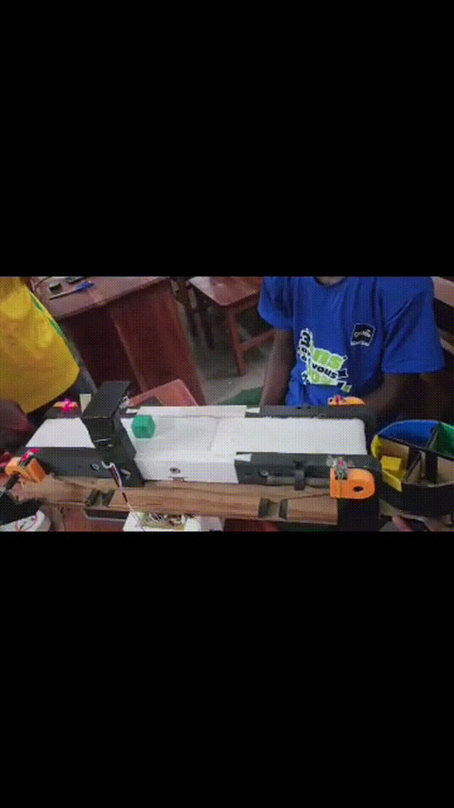

<link rel="stylesheet" href="/assets/css/custom-theme.css">

Project 01 · Group project
<h1>Color Cube Sorter</h1>
An automatic color-sorting line: a camera identifies cubes on a conveyor, a servo directs them into bins, and a Blynk dashboard tracks the process.
<h2>How it works</h2><ol><li>A start laser detects a cube and starts the conveyor.</li><li>An ultrasonic sensor triggers the camera; HSV color identification is sent to the ESP32 master over UART.</li><li>The conveyor carries each cube while its state is tracked.</li><li>An end laser triggers the servo to position the bin.</li><li>A calculated delay lets the cube reach the bin; counters and dashboard data update.</li></ol>
At the documented defaults (24 rpm, 10 cm roller perimeter, 5 cm sensor-to-bin distance), belt speed is 4 cm/s and drop delay is 1250 ms.

Hardware: ESP32 master, XIAO ESP32-S3 Sense, ultrasonic sensor, NEMA 17 stepper with TB6600 driver, SG90 servo, two laser/LDR barriers, I2C LCD and status LEDs. Unknown colors and emergency stops stop the belt; software debounce, an inactivity watchdog, persistent counters and non-blocking sorting logic support safe operation. The dashboard shows per-color and total counts, last item, timestamped log and a live chart. The README provides no numeric performance results.
<h2>My role</h2>
I lead the club that built this project. [TODO: what I personally designed or built]

ESP32 XIAO ESP32-S3 Sense Stepper motor Blynk
<a class="button" href="https://github.com/doriqu/color-cube-sorter">GitHub ↗</a>

