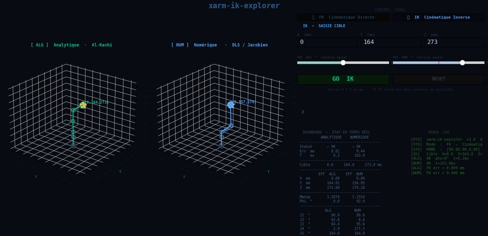

<link rel="stylesheet" href="/assets/css/custom-theme.css">

Project 02 · Solo project
<h1>IK Explorer</h1>
A from-scratch kinematics study for the 5-DOF X-Arm, comparing analytical and Damped Least Squares solvers.

Solo project to learn kinematics deeply. From the X-Arm URDF, I extracted link lengths, built the DH table and derived forward and inverse kinematics without the manufacturer's IK library.

The analytical solver uses geometry and Al-Kashi's law of cosines. The numerical solver uses Damped Least Squares with the Jacobian and multi-restart. An interactive 3D Matplotlib visualizer compares FK sliders, IK target input, animated motion, error, computation time, manipulability and debug log. A mirror method handles targets behind the robot (Y &lt; 0).
<ul><li>Analytical: average error &lt; 0.05 mm, &lt; 1 ms, deterministic.</li><li>Numerical: tolerance &lt; 10 mm, 1–100 ms, non-deterministic due to random restarts.</li></ul>
[TODO: add the technical report PDF link.]

Python NumPy Matplotlib DH parameters Al-Kashi DLS/Jacobian
<a class="button" href="https://github.com/doriqu/xarm-ik-explorer">GitHub ↗</a>

